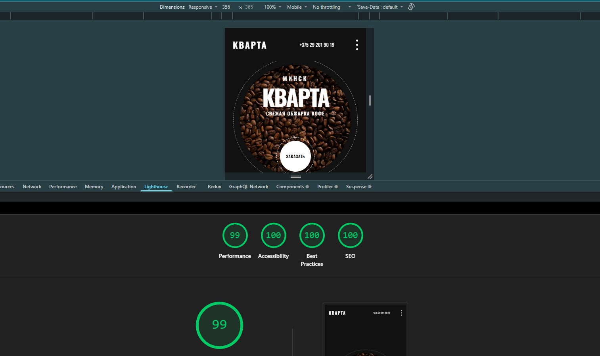
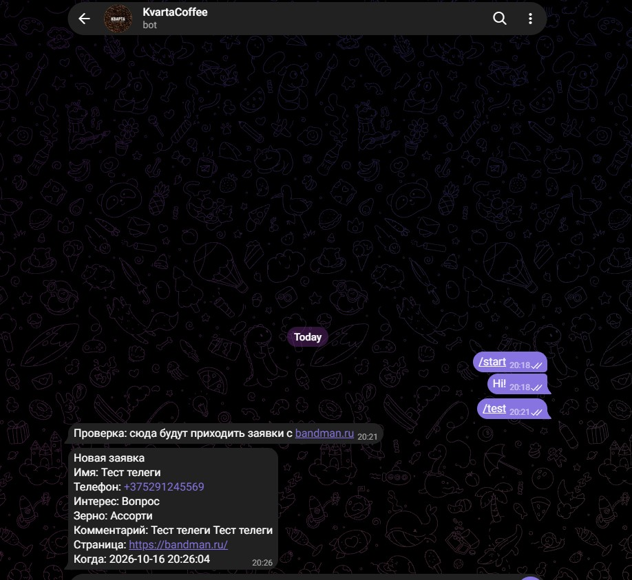
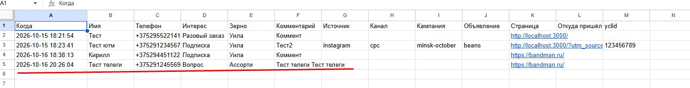

# Кварта

[План](PLAN.md) · [Чат](CHAT.MD)

## Ссылки

| | |
| --- | --- |
| Результат | https://bandman.ru/ |
| Репозиторий | https://github.com/KiHlot/vitaiapp |
| Лог работы с ИИ | [CHAT.MD](https://github.com/KiHlot/vitaiapp/blob/master/CHAT.MD) |
| Отчёт о выполнении | [README.md](https://github.com/KiHlot/vitaiapp/blob/master/README.md) |
| Telegram-бот | [@KvartaCoffeeBot](https://t.me/KvartaCoffeeBot) |

## О работе

- **Агенты:** Грок 4,7 + Клауди Опус 5,5
- **IDE:** Cursor
- **Время выполнения:** около 6 часов
- **Стек:** Next.js + TypeScript (без пакетов)

## Что сделал ИИ

- Всю вёрстку лендинга и страницу 404. В вёрстку самостоятельно не лез, давал только команды на исправление, в основном по SEO.
- Исправил производительность в Lighthouse (с 82 до 99). Перевёл изображения в WebP.
- Подключил Google Таблицы для сбора заказов. Я настроил только токен.
- Подключил Telegram-бота. Я создал бота по инструкции.

## Что сделал я

- Деплой проекта на свой хостинг.
- Коммиты.

## Проблемы

### Деплой

У меня нет аккаунта Vercel, а зарегистрировать его из Беларуси невозможно, поэтому пришлось заливать проект вручную на свой хостинг.

Потом командами по SSH попытался поставить `node_modules` и запустить Next — это тоже не удалось, пришлось общаться с техподдержкой. В итоге пришли к выводу, что для Next нужен VPS-сервер. Его долго настраивать, а время ограничено, и это платная услуга — для тестового задания избыточно.

Поработал с агентом: лендинг очень простой, отправляется только одна форма, поэтому ИИ переписал структуру так, чтобы она работала без модулей. Костыль сработал.

Добавлю: конкретно для этого лендинга Next избыточен, хватило бы классической вёрстки и формы на JS.

### Превью ссылки в мессенджерах

OG-картинка добавлена, в Instagram всё в порядке. На момент написания README превью ссылки не работало в Telegram. Думаю, появится, когда Telegram обновит кэш сайта.

## Дополнительно

Информацию о заказах решил собирать в Google Таблицы: на практике уже с таким сталкивался, это нормальное и удобное решение для заказчика.

## Скриншоты

### Lighthouse

### Дублирование заявок в Telegram

